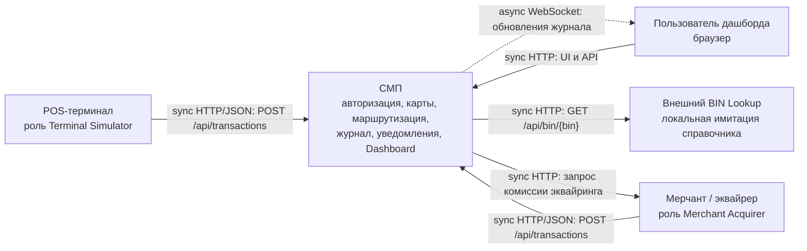

# А1. C4 Level 1 — контекст

**Чего не хватало:** отдельной диаграммы контекста с границей СМП, внешними участниками и протоколами взаимодействия.

**Что сделано:** показаны терминал, мерчант/эквайрер, пользователь дашборда и внешний BIN Lookup, подписаны HTTP- и WebSocket-связи.

## Подтверждение кодом

| Связь | Источник |
|---|---|
| Терминал → Gateway, получение тестовых карт | [Terminal GatewayClient](../../../services/terminal-simulator/src/main/java/com/processing/terminalsimulator/client/GatewayClient.java), `sendToGateway`, HTTP URI |
| Merchant → Gateway | [Merchant GatewayClient](../../../services/merchant-acquirer/src/main/java/com/processing/merchantacquirer/client/GatewayClient.java), `/api/transactions` |
| Браузер → Dashboard → Gateway, Logger → браузер | [nginx.conf](../../../services/dashboard/nginx.conf), `/api/` и `/ws/`, [useWebSocket](../../../services/dashboard/src/hooks/useWebSocket.ts) |
| Authorization → BIN Lookup | [BinLookupClient](../../../services/authorization/src/main/java/com/processing/authorization/client/BinLookupClient.java), `getIssuerId`, [BinLookupController](../../../services/bin-lookup/src/main/java/com/processing/binlookup/controller/BinLookupController.java) |
| Switch → Merchant для комиссии | [RouteService](../../../services/switch/src/main/java/com/processing/service/RouteService.java), `fetchAcquiringFee`, [MerchantAcquirerClient](../../../services/switch/src/main/java/com/processing/service/MerchantAcquirerClient.java) |
