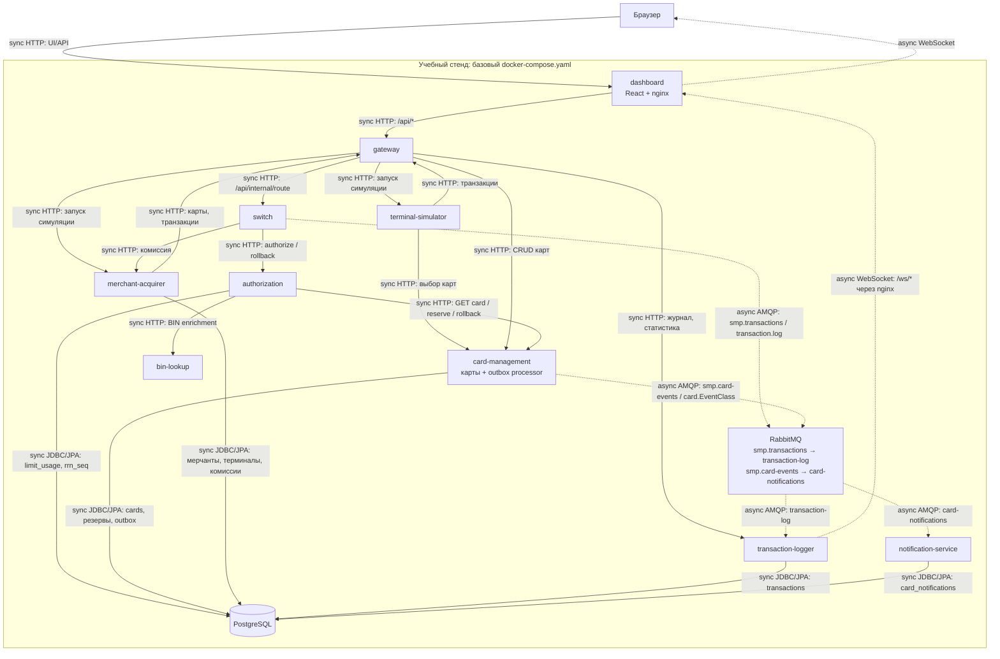

# А2. C4 Level 2 - контейнеры

**Чего не хватало:** разделения sync/async-связей, отображения outbox

**Что сделано:** показаны все прикладные контейнеры базового стенда, PostgreSQL и RabbitMQ, подписаны HTTP/JDBC- и AMQP-связи, exchange и очереди

## Подтверждение связей

| Группа связей | Файлы |
|---|---|
| Gateway → Switch/CMS/Logger/симуляторы | [Gateway application.yml](../../../services/gateway/src/main/resources/application.yml), `spring.cloud.gateway.routes` |
| Dashboard, WebSocket | [nginx.conf](../../../services/dashboard/nginx.conf), [WebSocketConfig](../../../services/transaction-logger/src/main/java/com/processing/transactionlogger/websocket/WebSocketConfig.java) |
| Симуляторы → Gateway/CMS | [Terminal GatewayClient](../../../services/terminal-simulator/src/main/java/com/processing/terminalsimulator/client/GatewayClient.java), [Merchant GatewayClient](../../../services/merchant-acquirer/src/main/java/com/processing/merchantacquirer/client/GatewayClient.java) |
| Switch → Authorization/Merchant | [RouteService](../../../services/switch/src/main/java/com/processing/service/RouteService.java), [AuthorizationClient](../../../services/switch/src/main/java/com/processing/service/AuthorizationClient.java), [MerchantAcquirerClient](../../../services/switch/src/main/java/com/processing/service/MerchantAcquirerClient.java) |
| Authorization → CMS/BIN/БД | [AuthServiceImpl](../../../services/authorization/src/main/java/com/processing/authorization/services/AuthServiceImpl.java), [LimitUsageRepository](../../../services/authorization/src/main/java/com/processing/authorization/repositories/LimitUsageRepository.java) |
| CMS → БД/outbox/AMQP | [CardServiceImpl](../../../services/card-management/src/main/java/com/processing/cardmanagement/services/CardServiceImpl.java), [OutboxProcessor](../../../services/card-management/src/main/java/com/processing/cardmanagement/services/OutboxProcessor.java), [OutboxEventProcessorImpl](../../../services/card-management/src/main/java/com/processing/cardmanagement/services/OutboxEventProcessorImpl.java) |
| Merchant → БД | [MerchantRepository](../../../services/merchant-acquirer/src/main/java/com/processing/merchantacquirer/repository/MerchantRepository.java), [TerminalRepository](../../../services/merchant-acquirer/src/main/java/com/processing/merchantacquirer/repository/TerminalRepository.java), [AcquirerFeeRepository](../../../services/merchant-acquirer/src/main/java/com/processing/merchantacquirer/repository/AcquirerFeeRepository.java) |
| AMQP → Logger → БД | [TransactionLogListener](../../../services/transaction-logger/src/main/java/com/processing/transactionlogger/listener/TransactionLogListener.java), [TransactionService](../../../services/transaction-logger/src/main/java/com/processing/transactionlogger/service/TransactionService.java) |
| AMQP → Notification → БД | [CardEventListener](../../../services/notification-service/src/main/java/com/processing/notification/listener/CardEventListener.java) |

