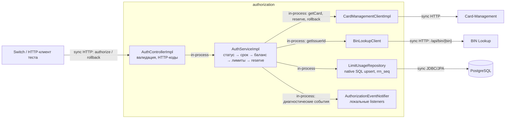
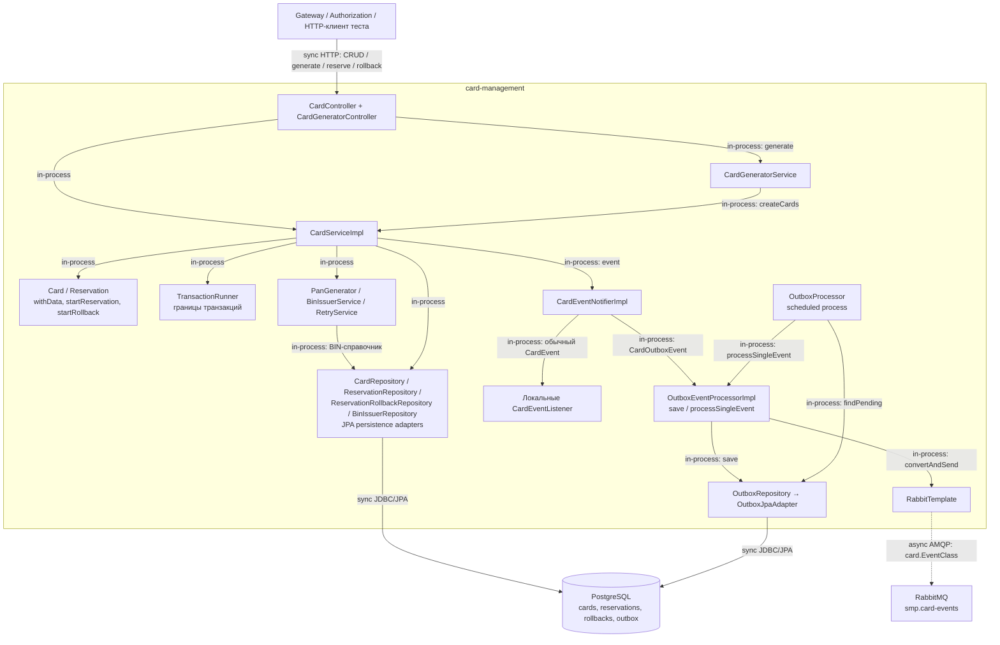

# А3. C4 Level 3 - Authorization и Card-Management

**Чего не хватало:** компонентных диаграмм Authorization и Card-Management с внутренними вызовами и внешними зависимостями.

**Что сделано:** показаны контроллеры, сервисы, HTTP-клиенты, репозитории и outbox-процессор, отмечены внутрипроцессные вызовы и границы HTTP, JDBC и AMQP.

## Authorization

## Card-Management

| Компонент / связь | Подтверждение |
|---|---|
| HTTP → бизнес-логика | [CardController](../../../services/card-management/src/main/java/com/processing/cardmanagement/controllers/CardController.java), [CardGeneratorService](../../../services/card-management/src/main/java/com/processing/cardmanagement/services/CardGeneratorService.java) |
| Домен и транзакции | [CardServiceImpl](../../../services/card-management/src/main/java/com/processing/cardmanagement/services/CardServiceImpl.java), [Card](../../../services/card-management/src/main/java/com/processing/cardmanagement/models/Card.java), [Reservation](../../../services/card-management/src/main/java/com/processing/cardmanagement/models/Reservation.java), [TransactionRunner](../../../services/card-management/src/main/java/com/processing/cardmanagement/services/TransactionRunner.java) |
| Доступ к PostgreSQL | [CardRepositoryPersistenceAdapter](../../../services/card-management/src/main/java/com/processing/cardmanagement/repositories/CardRepositoryPersistenceAdapter.java), [CardJpaRepository](../../../services/card-management/src/main/java/com/processing/cardmanagement/repositories/CardJpaRepository.java), [BinIssuerServiceImpl](../../../services/card-management/src/main/java/com/processing/cardmanagement/services/BinIssuerServiceImpl.java) |
| Событие → запись outbox | [CardEventNotifierImpl](../../../services/card-management/src/main/java/com/processing/cardmanagement/events/CardEventNotifierImpl.java), [OutboxJpaAdapter](../../../services/card-management/src/main/java/com/processing/cardmanagement/repositories/OutboxJpaAdapter.java) |
| Чтение outbox → публикация | [OutboxProcessor](../../../services/card-management/src/main/java/com/processing/cardmanagement/services/OutboxProcessor.java), [OutboxEventProcessorImpl](../../../services/card-management/src/main/java/com/processing/cardmanagement/services/OutboxEventProcessorImpl.java), [RabbitMQConfig](../../../services/card-management/src/main/java/com/processing/cardmanagement/config/RabbitMQConfig.java) |

Не все изменения автоматически дают одно событие: публикуются только классы, реализующие `CardOutboxEvent`. Например, [CardServiceCreationEvent](../../../services/card-management/src/main/java/com/processing/cardmanagement/events/CardServiceCreationEvent.java) содержит количество созданных карт, а не PAN

