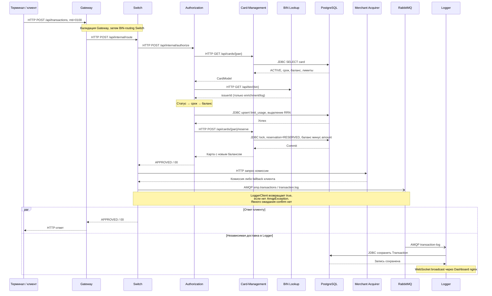
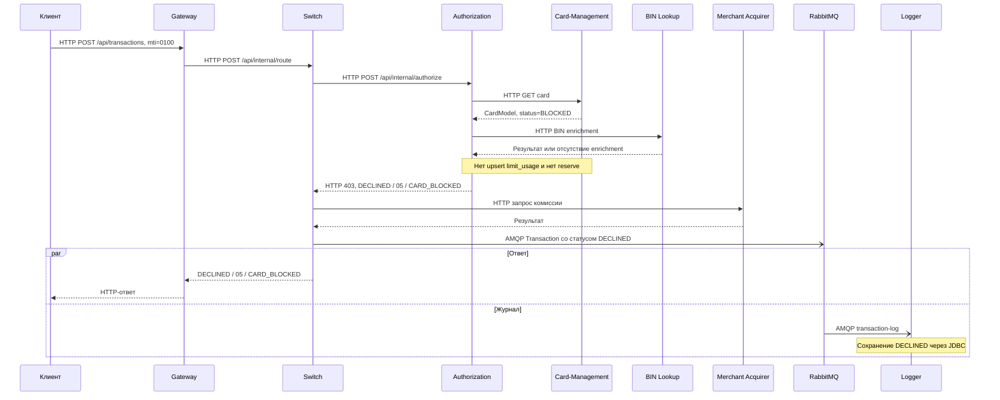
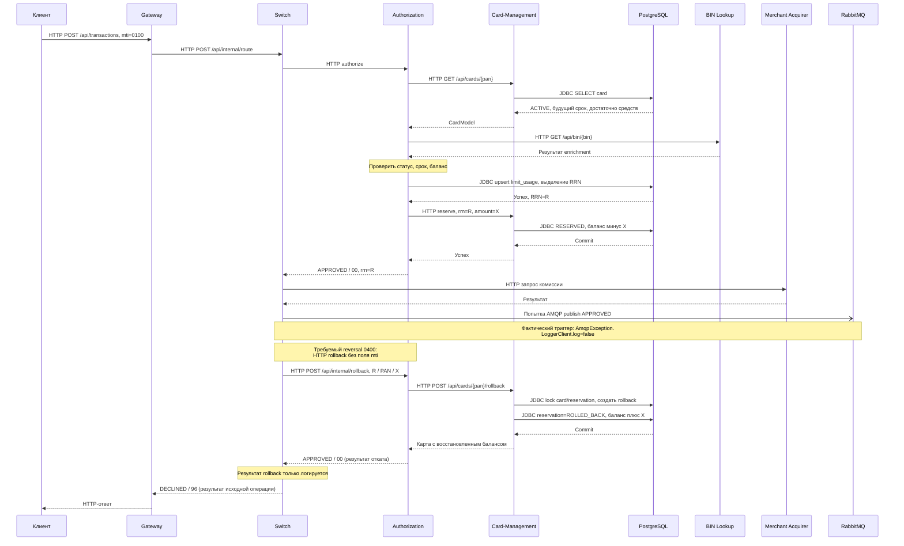

# А4. Sequence - одобрение, отказ и reversal

**Чего не хватало:** сценариев declined и reversal, исходная диаграмма покрывала только happy path.

**Что сделано:** разобраны одобрение, отказ для BLOCKED-карты и компенсация после ошибки публикации, разделены синхронные вызовы и асинхронная доставка

## 1. Happy path

## 2. Declined: карта BLOCKED

## 3. Reversal

## Подтверждение кодом

| Фрагмент | Источник |
|---|---|
| Вход и маршрутизация Gateway | [TransactionRequestValidator](../../../services/gateway/src/main/java/com/processing/gateway/validation/TransactionRequestValidator.java), [application.yml](../../../services/gateway/src/main/resources/application.yml) |
| Оркестрация трёх сценариев, комиссия, публикация, rollback | [RouteService](../../../services/switch/src/main/java/com/processing/service/RouteService.java), `route`, [AuthorizationClient](../../../services/switch/src/main/java/com/processing/service/AuthorizationClient.java) |
| Порядок проверок, лимиты, reserve и rollback | [AuthServiceImpl](../../../services/authorization/src/main/java/com/processing/authorization/services/AuthServiceImpl.java), [AuthControllerImpl](../../../services/authorization/src/main/java/com/processing/authorization/controller/AuthControllerImpl.java) |
| Фактический контракт отката | [RollbackRequest](../../../services/common/src/main/java/com/processing/common/dto/authorization/RollbackRequest.java), [CardManagementClientImpl](../../../services/authorization/src/main/java/com/processing/authorization/client/CardManagementClientImpl.java) |
| Резервирование и возврат средств | [CardServiceImpl](../../../services/card-management/src/main/java/com/processing/cardmanagement/services/CardServiceImpl.java), `reserve`, `rollback` |
| Публикация и доставка | [LoggerClient](../../../services/switch/src/main/java/com/processing/service/LoggerClient.java), [Switch config](../../../services/switch/src/main/resources/application.yml), [TransactionLogListener](../../../services/transaction-logger/src/main/java/com/processing/transactionlogger/listener/TransactionLogListener.java), [TransactionService](../../../services/transaction-logger/src/main/java/com/processing/transactionlogger/service/TransactionService.java) |
