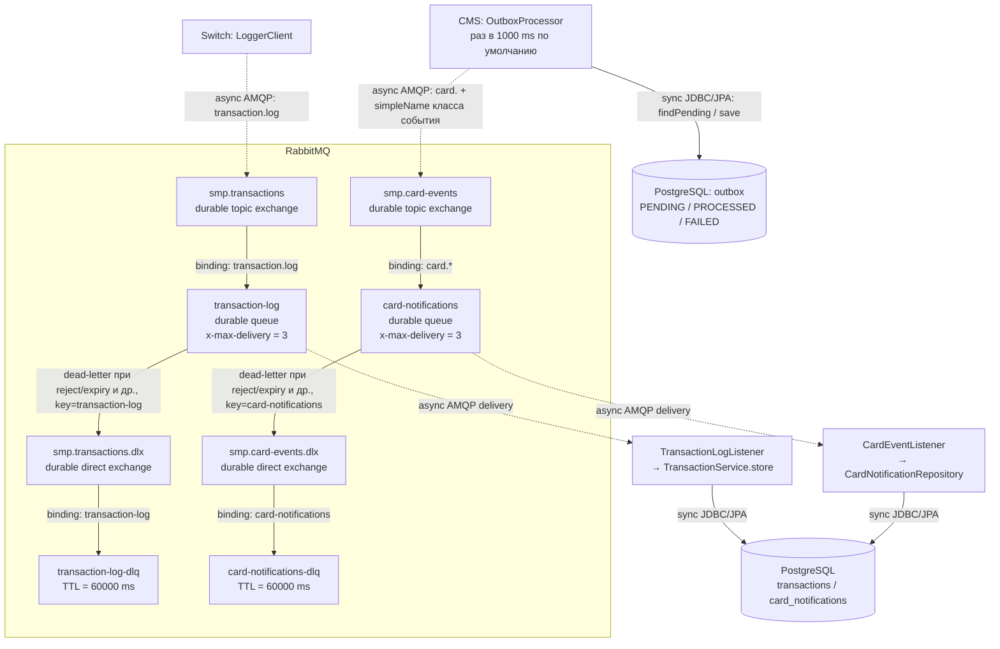

# А5. RabbitMQ - топология и границы гарантий

**Чего не хватало:** визуальной карты exchange → queue → consumer и различения publisher-confirm, повторов consumer, повторов outbox и TTL.

**Что сделано:** нанесены имена exchange/queue, routing keys, DLX/DLQ и параметры из кода. Пунктир - async AMQP, сплошные стрелки внутри брокера - маршрутизация. JDBC-переходы подписаны отдельно.

## Подтверждение кодом

| Элемент | Источник |
|---|---|
| Полная transaction-топология, включая DLX/DLQ | [Switch RabbitMQConfig](../../../services/switch/src/main/java/com/processing/config/RabbitMQConfig.java) |
| Повторное объявление основного transaction exchange/queue | [Logger RabbitMQConfig](../../../services/transaction-logger/src/main/java/com/processing/transactionlogger/config/RabbitMQConfig.java), этот класс сам DLX/DLQ не объявляет |
| Полная card-топология, `card.*` | [CMS RabbitMQConfig](../../../services/card-management/src/main/java/com/processing/cardmanagement/config/RabbitMQConfig.java), [Notification RabbitMQConfig](../../../services/notification-service/src/main/java/com/processing/notification/config/RabbitMQConfig.java) |
| Поведение producer Switch | [LoggerClient](../../../services/switch/src/main/java/com/processing/service/LoggerClient.java), [application.yml](../../../services/switch/src/main/resources/application.yml) |
| Поведение producer CMS и счётчик повторов | [OutboxEventProcessorImpl](../../../services/card-management/src/main/java/com/processing/cardmanagement/services/OutboxEventProcessorImpl.java), [OutboxProcessor](../../../services/card-management/src/main/java/com/processing/cardmanagement/services/OutboxProcessor.java), [CardOutboxEventData](../../../services/card-management/src/main/java/com/processing/cardmanagement/models/CardOutboxEventData.java), [application.properties](../../../services/card-management/src/main/resources/application.properties) |
| Consumer Logger и его конфигурация | [TransactionLogListener](../../../services/transaction-logger/src/main/java/com/processing/transactionlogger/listener/TransactionLogListener.java), [application.yaml](../../../services/transaction-logger/src/main/resources/application.yaml) |
| Consumer Notification и его конфигурация | [CardEventListener](../../../services/notification-service/src/main/java/com/processing/notification/listener/CardEventListener.java), [application.yml](../../../services/notification-service/src/main/resources/application.yml) |

