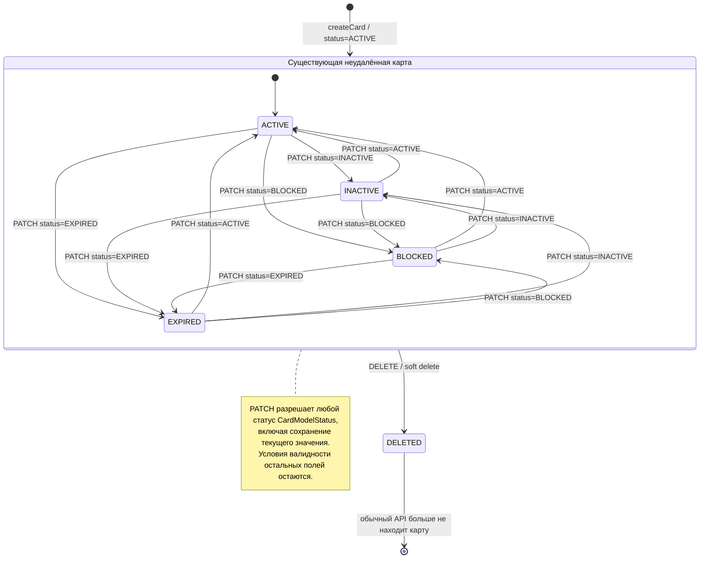
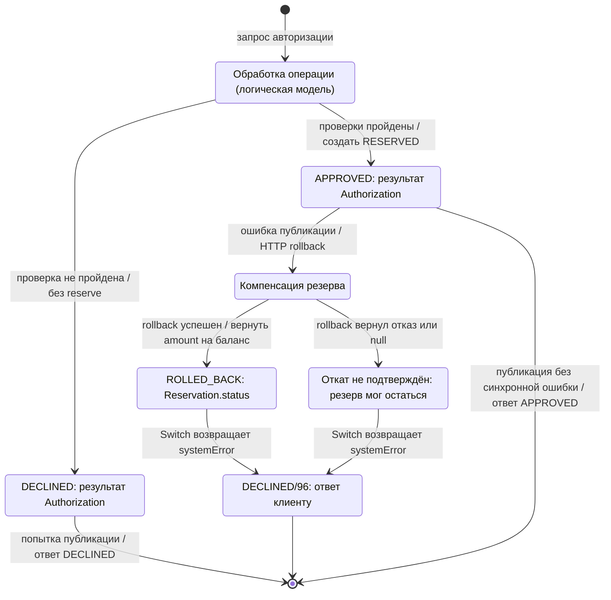

# А6. State-transition - карта, транзакция и резерв

**Чего не хватало:** диаграмм переходов и разграничения результата авторизации и состояния резерва.

**Что сделано:** построены переходы по методам модели и сервиса

## Card.status

## Результат Transaction и состояние Reservation

## Подтверждение кодом

| Элемент | Источник |
|---|---|
| Статусы и операции над картой | [CardStatus](../../../services/card-management/src/main/java/com/processing/cardmanagement/models/CardStatus.java), [CardModelStatus](../../../services/common/src/main/java/com/processing/common/dto/cardmanagement/CardModelStatus.java) (без DELETED во входном DTO), [Card](../../../services/card-management/src/main/java/com/processing/cardmanagement/models/Card.java), `withData`, `deleted`, `checkStatusOrThrow` |
| PATCH/DELETE/bulk и границы транзакций | [CardController](../../../services/card-management/src/main/java/com/processing/cardmanagement/controllers/CardController.java), [CardServiceImpl](../../../services/card-management/src/main/java/com/processing/cardmanagement/services/CardServiceImpl.java) |
| Исключение удалённых карт | [CardEntity](../../../services/card-management/src/main/java/com/processing/cardmanagement/models/CardEntity.java) |
| Проверка статуса и срока | [AuthServiceImpl](../../../services/authorization/src/main/java/com/processing/authorization/services/AuthServiceImpl.java), [DeclineOutcome](../../../services/authorization/src/main/java/com/processing/authorization/constants/DeclineOutcome.java) |
| Состояния резерва | [Reservation](../../../services/card-management/src/main/java/com/processing/cardmanagement/models/Reservation.java), `startRollback`, `rolledBack` |
| Компенсация и ответ 96 | [RouteService](../../../services/switch/src/main/java/com/processing/service/RouteService.java), `route`, `logRollbackResult` |
